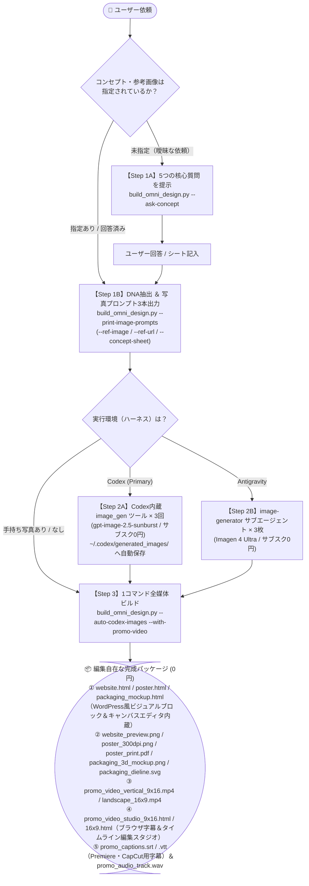

# Omni-Design Studio（3ステップ決定論的デザイン＆プロモ動画統合スキル）

> **🎯 設計思想（なぜ下位モデルでもプロ品質になるのか？）**
> 複雑な判断（色彩抽出・キャッチコピー合成・非対称エディトリアル組版・300DPI PDF/SVG展開図・24fps動画イージング＆音声合成）をすべて **`build_omni_design.py` 1本の決定論的Pythonパイプライン（Formula-First）** に封じ込めています。
> AIエージェント（上位・下位モデル問わず）は、以下の **「3ステップ（①準備 ➔ ②写真3枚生成 ➔ ③一括ビルド）」** を順番に実行するだけで、常に人間デザイナー品質の成果物を出力できます。

---

## 🗺️ 全体アーキテクチャ図（3ステップ・ステートマシン）



---

## ⚡ 下位モデルでも絶対に迷わない「3ステップ実行ルール」

スクリプトのパスは常に以下1本のみを使います（他のサブスクリプトは内部で自動呼び出しされます）：
`SCRIPT="$HOME/.codex/skills/omni-design-studio/scripts/build_omni_design.py"`

### Step 1: 【絶対必須・スキップ厳禁】サンプルWebサイトの検索・画像取り込み ＆ コンセプト確認
> 🚨 **絶対規律（Reference Image Capture Gate & Anti-AI-Slop Linter）**
> 「参考画像がない場合は省略してよい」という例外は**完全廃止**されました。
> デザインを作成する際は、**必ず最初に実在するベンチマークWebサイト（最低2〜3サイト）を検索してPlaywrightでスクリーンショット画像として取り込む（`--benchmark-urls` / `--ref-url`）か、ユーザーの参考デザイン画像（`--ref-image`）を取り込み**、`REFERENCE_BENCHMARK_PROOF.json` と比較コンタクトシート（`BENCHMARK_CONTACT_SHEET.png`）を生成しなければなりません。この画像取り込み証跡がない場合、スクリプトは `SystemExit(1)` で物理停止します。
> また、出力HTML/CSSは `reference_gate.py` の **`lint_html_against_ai_slop`** によって機械検査され、AI特有の安っぽい装飾（`border-radius: 999px` のピルバッジ連発、`✓` アイコン箇条書き、角丸SaaSカード枠、見出し絵文字）が1つでも含まれているとビルドが強制遮断されます。

1. **キャッチコピーやコンセプトが未定の場合**は、まず以下を実行してユーザーに核心質問を尋ねます：
   ```bash
   python3 "$SCRIPT" --ask-concept
   ```
   *(テンプレート正本: `templates/CONCEPT_QUESTION_SHEET.md`)*
2. **実在するサンプルWebサイトを画像として取り込み、色彩・余白・タイポグラフィDNAを抽出する（必須）**：
   ```bash
   python3 "$SCRIPT" \
     --brand "ブランド名" \
     --category "商品カテゴリ" \
     --benchmark-urls "https://example-benchmark-1.jp/" "https://example-benchmark-2.jp/" \
     --ref-image "/path/to/reference.png" \
     --print-image-prompts
   ```

### Step 2: サブスク0円の最上位モデルで写真素材を3枚生成する（文字なし写真）
Step 1 で出力された3つのプロンプト（`hero_image_prompt`, `poster_image_prompt`, `pack_image_prompt`）を使い、文字を含まない純粋な商業スタジオ写真を3枚生成します（**APIキー従量課金は厳禁・サブスク範囲内のみ**）：
- **🅰️ Codex で実行中の場合（第1優先: `gpt-image-2.5-sunburst`）**:
  Codex 内蔵の **`image_gen` ツール** を3回呼び出す（`~/.codex/generated_images/` に自動保存されます）。
- **🅱️ Antigravity で実行中の場合（`Imagen 4 Ultra / Nano Banana 2.1`）**:
  `invoke_subagent(TypeName="image-generator")` を呼び出して3枚生成し、保存パスを受け取る。
- **🅲 ユーザーに写真を用意してもらう場合**:
  Step 1（`--print-image-prompts` を外した実行）が出力する「📋 エージェントからの素材リクエスト（必要な写真の構図・推奨サイズ・AIプロンプト案）」をそのままユーザーに伝える。

### Step 3: 1コマンドで全デザイン＆プロモ動画を一括出力する
あとは以下の1コマンドを実行するだけで、**WordPressのようにブラウザ上で画像・文字・要素・レイアウトを自由自在に編集できる3つのHTML**、高解像度PNG/PDF/SVG、および**後からキャプションや映像を自在に編集できるプロモーショナルビデオ一式**がすべて完成します：

```bash
# Codex の場合（--auto-codex-images で Step 2 の生成画像を自動バインド）
python3 "$HOME/.codex/skills/omni-design-studio/scripts/build_omni_design.py" \
  --auto-codex-images \
  --target all \
  --with-promo-video \
  --brand "LUMIÈRE & CO." \
  --category "イヤリング・ファインジュエリー" \
  --headline "Luminous Craft," \
  --subcopy "18Kリサイクルゴールドとあこや真珠が織りなす、有機的なイヤリングコレクション" \
  --out-dir ~/Downloads/omni_output_pack

# Antigravity / Claude Code または個別画像パス指定の場合
python3 "$HOME/.codex/skills/omni-design-studio/scripts/build_omni_design.py" \
  --target all \
  --with-promo-video \
  --brand "LUMIÈRE & CO." \
  --category "イヤリング・ファインジュエリー" \
  --headline "Luminous Craft," \
  --subcopy "18Kリサイクルゴールドとあこや真珠が織りなす、有機的なイヤリングコレクション" \
  --hero-image /path/to/hero.jpg \
  --poster-image /path/to/poster.jpg \
  --pack-image /path/to/pack.jpg \
  --out-dir ~/Downloads/omni_output_pack
```

---

## 🎨 出力後のWordPress風ビジュアル編集 ＆ 動画キャプション編集機能（標準内蔵）

生成される3つのデザインファイル（`website.html`, `poster.html`, `packaging_mockup.html`）と動画スタジオファイル（`promo_video_studio_9x16.html`, `promo_video_studio_16x9.html`）には、`cms_editor_runtime.py` により **WordPress（Gutenberg）/ Studio 風のビジュアルエディタ（`✦ OMNI WP-STUDIO`）** が自動内蔵されています。ブラウザで開くだけで以下の編集が可能です：

1. **文字の直接編集（Inline WYSIWYG）**: 見出し・本文・バッジ・縦書きコピーをクリックしてその場でタイピング修正、文字サイズ（`A+`/`A-`）・文字色・フォントファミリー（明朝 / 和モダン / ゴシック / ブルータリズム / スイスグリッド）をワンクリック変更。
2. **画像の差し替え＆枠シェイプ変更**: 画像をダブルクリック（またはPCからドラッグ＆ドロップ）するだけで別の写真に即座に差し替え可能。枠の形状も「アーチ窓 (`Arch`)」「角丸カード (`Bento`)」「直角 (`Sharp`)」「円形 (`Circle`)」へ自在に切り替え可能。
3. **要素・ブロック・レイアウトの自在な移動**: 選択した要素の上下左右移動（`↑`/`↓`/`←`/`→`）、ブロックの複製（`⧉`）・削除（`🗑️`）、新規テキスト/画像ブロック追加（`＋ 文字追加` / `🖼️ 画像追加`）、左右2カラム構成のワンクリック反転（`⇄ レイアウト反転`）。
4. **編集済みHTML保存 ＆ PDF書き出し**: ツールバーの `💾 HTML保存` で編集後の状態を単一HTMLとして保存、`🖨️ PDF出力` でツールバーを自動非表示にした高解像度PDF/印刷を出力。
5. **動画の事後編集・キャプション編集（Post-Production Ready）**:
   - `promo_video_studio_9x16.html` / `16x9.html`: 下部のタイムラインバーで `Scene 1〜4` をシーク・再生しながら、動画内の字幕（キャプション）・見出し・写真を直接書き換え、`📝 SRT字幕を保存` ボタンで編集後の字幕ファイルを即書き出し可能。
   - `promo_captions.srt` / `promo_captions.vtt` / `promo_audio_track.wav`: Premiere Pro、CapCut、DaVinci Resolve、Final Cut Pro 等にそのまま読み込んで字幕差し替えやBGM/ナレーションの再編集が可能。

---

## 🛠️ オプション機能リファレンス（必要な時だけ使用）

| やりたいこと | 追加するフラグ / コマンド |
| :--- | :--- |
| **記入済みコンセプトシートからコピーを自動反映** | `--concept-sheet /path/to/CONCEPT_QUESTION_SHEET.md` |
| **参考画像 / 参考URLの色・テイスト・フォントを完全再現** | `--ref-image /path/to/sample.jpg` または `--ref-url https://...` |
| **デザインスタイルを手動指定**（既定は `organic_editorial`） | `--trend [organic_editorial \| japanese_luxury \| bento_glass \| neo_brutalism \| swiss_editorial \| cyber_pop]` |
| **人間デザイナー100選のコンタクトシートを生成** | `python3 .../scripts/curate_human_designs.py --out-dir ~/Downloads/curation_100` |
| **量産モード（Plan B: DeepSeek + Flux 約0.6円/点）** | `--plan plan_b`（既定は `--plan plan_a` = サブスク0円） |

